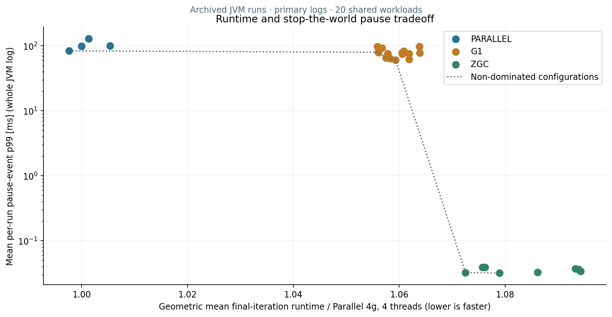
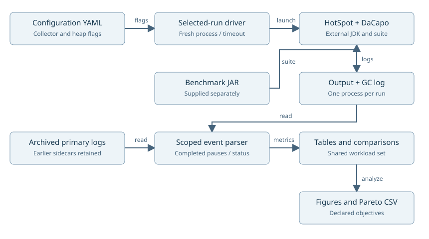

# Garbage collector benchmarking research

A JVM benchmarking study of Parallel GC, G1, and ZGC using DaCapo Chopin workloads. The project combines configurable benchmark runs, unified-GC-log analysis, and runtime/pause tradeoff exploration.



*Reanalysis of historical JDK 21 logs: normalized final-iteration runtime versus the mean per-run p99 of whole-JVM pause events. These axes have different measurement windows. They are not application-response latency or new benchmark measurements.*

**Java / HotSpot · DaCapo · Python · Bash · YAML · CSV · Matplotlib**

[Run guide and metric definitions](docs/SETUP.md) · [Technical brief report](docs/report.pdf) · [Overleaf ZIP](docs/report-overleaf.zip)

## Research work

- Define 28 collector configurations covering heap size, GC worker counts, and G1 pause targets.
- Automate DaCapo processes and retain JVM logs and workload output for inspection.
- Extract completed stop-the-world events, distinguish them from concurrent ZGC cycle statistics, and handle decimal-comma logs.
- Compare configurations across a shared workload set using normalized runtime and explicit pause metrics.
- Explore non-dominated runtime/pause choices without treating one configuration as universally best.

The archive contains **616 primary run folders** across 22 workloads and 28 configurations. **560 outputs have passing markers**, yielding a balanced comparison across 20 workloads. Cassandra and h2o remain unconfirmed in the supplied output. The original summary CSV contains 559 rows and is preserved separately from the current reanalysis.

## Reproduce the analysis

```sh
python3 -m pip install -r requirements.txt
python3 tools/analyze.py
python3 tools/plot_results.py
python3 -m unittest discover -s tests -v
```

This workflow reads the packaged logs and writes CSV summaries, a Pareto table, and figures under `build/`. It requires no benchmark JAR or JVM installation. A separate synthetic smoke check exercises all three real local JVM collectors:

```sh
python3 tools/smoke.py --output build/my-smoke
```

That bounded allocation fixture was verified on JDK 17. It checks execution and parsing, and is not part of the DaCapo research results. See [setup](docs/SETUP.md) for planning and executing selected DaCapo runs on a compatible JDK with a separately obtained benchmark JAR.

## Experiment pipeline



| Path | Purpose |
| --- | --- |
| [configs.yaml](configs.yaml) | Original 28-configuration matrix |
| [tools/run_benchmarks.py](tools/run_benchmarks.py) | Selected-run planning, fresh directories, combined output and process metadata |
| [tools/metrics.py](tools/metrics.py) | Completed-pause and DaCapo-result parsing |
| [data/archive](data/archive) | Compressed original logs, including earlier log sidecars |
| [results/original](results/original) | Supplied CSVs and editable workbooks |
| [legacy](legacy) | Original collection, aggregation, and plotting scripts |

The historical metrics mix GC scopes and require care when interpreted. Current plots use completed pause records, keep earlier JVM logs separate, and preserve the original tables as evidence. Full DaCapo runs were not repeated here. Details and research limits are concentrated in the [metric guide](docs/SETUP.md#measurement-scope).

Research scripts identify **Dimitris Asimakopoulos, csd4845**, for the HY446 project. DaCapo and the JVM collectors are external systems under study, not collector implementations supplied by this repository.
