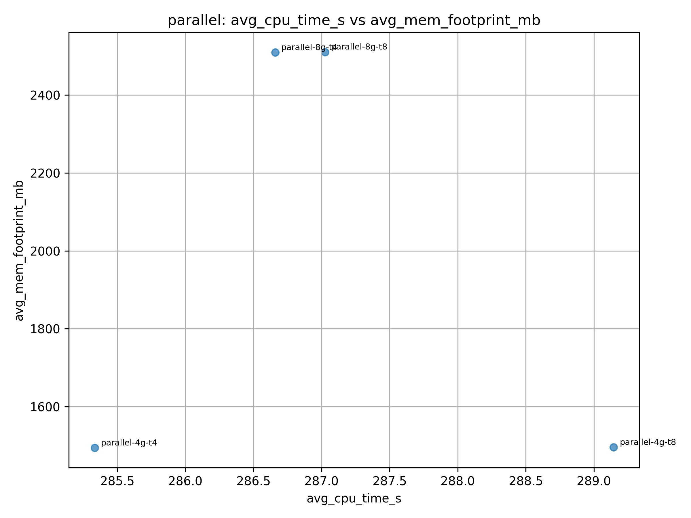
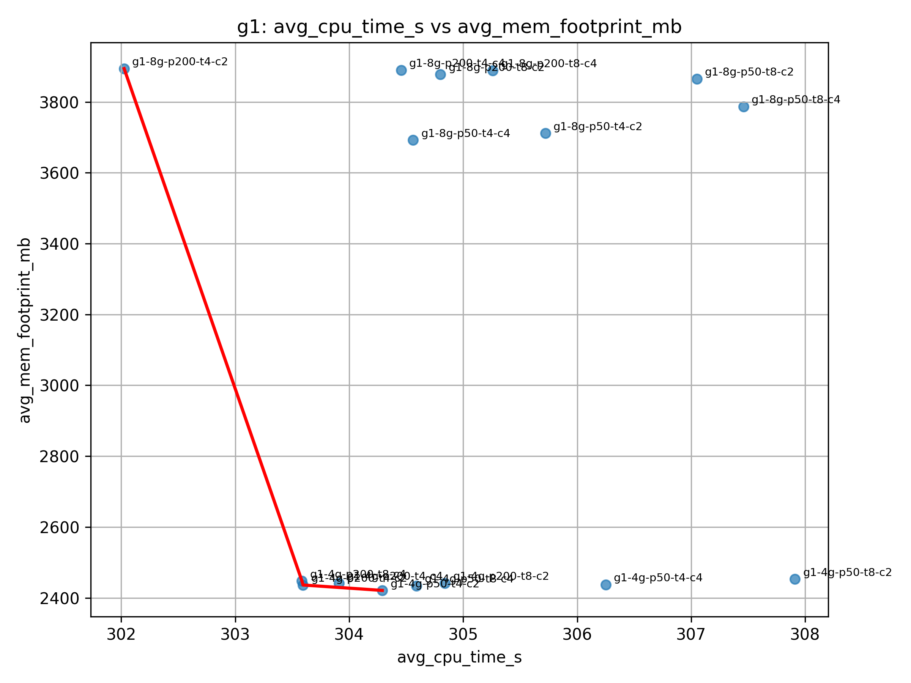
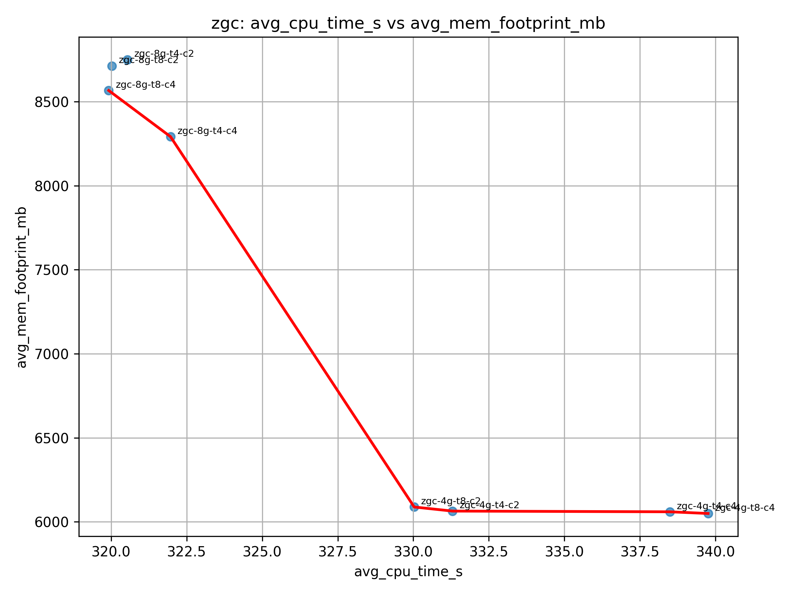
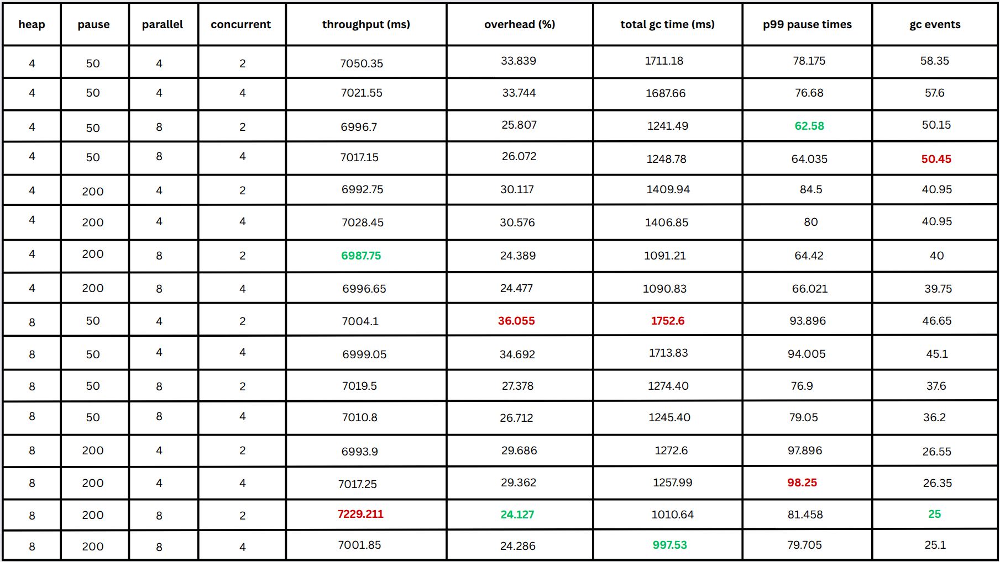
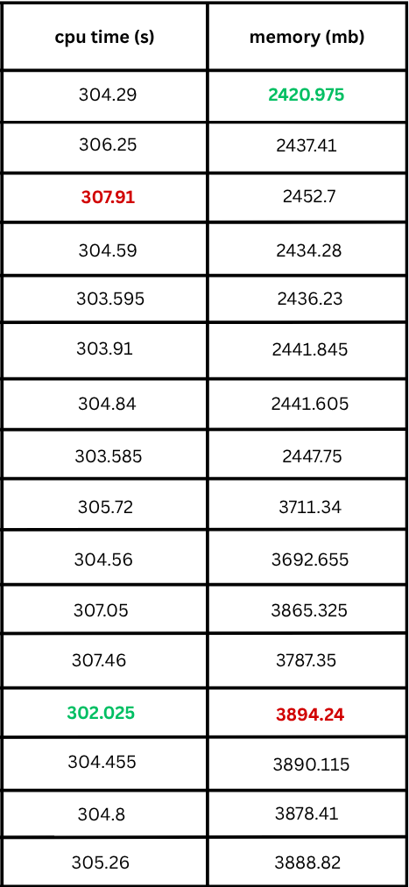
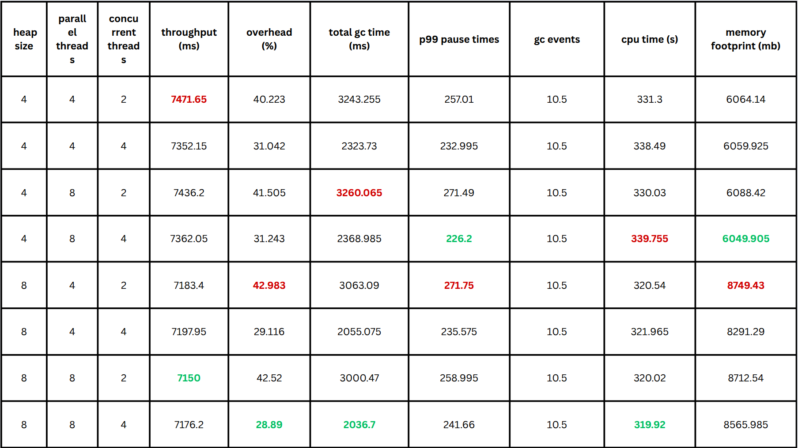
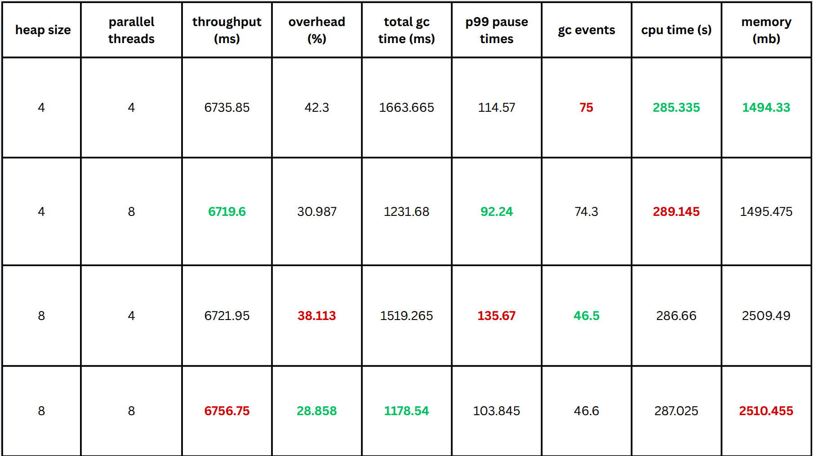
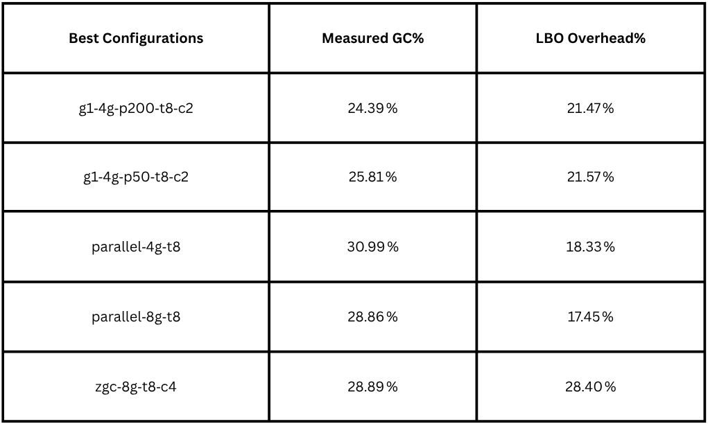

# Research documents and additional results

The original report and presentation describe the tuning study, experimental host, collector-specific results, and resource tradeoffs. They complement the [archived logs](../data/archive) and [current metric definitions](SETUP.md#measurement-scope).

## References

- **[R1]** [Project report, PDF](sources/project-report.pdf) · [editable ODT](sources/project-report.odt). *Garbage Collector Tuning Harness for DaCapo-Chopin*, HY446 Managed Runtime Systems. The PDF is a reading copy exported from the supplied ODT; its page references below refer to this export.
- **[R2]** [Project presentation, PDF](sources/project-presentation.pdf). *Garbage Collector Tuning Harness for DaCapo-Chopin*, 19 slides. Page references use PDF page numbers, including the title slide.
- **[R3]** [Original measurement tables and workbooks](../results/original) and [collection scripts](../legacy).

The supplied ODT and presentation PDF are preserved byte-for-byte. The extracted PNGs below retain their original pixels and labels; [image provenance](images/original/provenance.json) maps each file to its ODT member and document pages.

## Experiment context

The study explores how heap size, GC workers, concurrent workers, and G1 pause targets affect runtime, pauses, CPU demand, and memory. Its practical work includes a configurable execution harness, regular-expression log parsing, aggregation, and Pareto analysis [R1, pp. 1–4; R2, pp. 2–6].

The documents identify **Ubuntu 20.04, 16 GB RAM, and an Intel i7-3820 at 3.60 GHz with eight logical processors**, with ten DaCapo iterations per invocation [R1, p. 3; R2, p. 5]. Archived headers independently supply the JDK build and suite version listed in the [run guide](SETUP.md#plan-and-execute-dacapo-runs).

Both documents describe debugging and repeating runs three times. The archive preserves one primary record per workload/configuration plus earlier sidecars, rather than three complete, separately identified repetitions. The current analysis therefore makes no three-repeat or confidence-interval claim. The flag survey also discusses options outside the tested matrix, including Shenandoah; only Parallel GC, G1, and ZGC have configurations here.

## Reported CPU and memory results

The documents add **28 configuration-level CPU and memory summaries**, absent from the original archived CSV columns. [document-resource-summary.csv](../results/original/document-resource-summary.csv) transcribes those two columns from the presentation tables, preserving printed precision and source page references [R2, pp. 8, 11, 14; R1, pp. 5, 7, 9].

| Collector | Reported mean CPU time across configurations (s) | Reported mean memory across configurations (MB) |
| --- | ---: | ---: |
| Parallel GC | 285.335–289.145 | 1,494.330–2,510.455 |
| G1 | 302.025–307.910 | 2,420.975–3,894.240 |
| ZGC | 319.920–339.755 | 6,049.905–8,749.430 |

These ranges span configuration means, **not individual runs or uncertainty intervals**. They show the reported resource dimension of the original comparison: memory varies substantially with heap size, while CPU means vary less within each family. They do not establish a universal collector ranking.

CPU time is distinct from elapsed runtime and is not a utilization percentage. The report describes memory as peak RSS, but the archived scripts and tabular data do not retain the process-resource collection path or per-run samples needed to verify that definition. Units remain **MB as printed**, without conversion to MiB or a claim that they measure unique physical residency. In particular, the report's separate claims of per-workload ZGC memory exceeding host RAM require measurement-method verification. The underlying resource samples, workload averaging denominators, and repetition grouping cannot be independently reconstructed; these means must not be joined to current balanced run rows as if they shared verified provenance. Resource values are documentary evidence, not regenerated log metrics, and are excluded from the current Pareto calculation.

### Original resource plots

**Parallel GC** — report p. 10; presentation p. 15. The 4 GB and 8 GB groups separate strongly on reported memory, with a relatively narrow CPU range.

**G1** — report p. 6; presentation p. 9.

**ZGC** — report p. 8; presentation p. 12.

The red lines are retained from the original figures. They are not newly validated frontiers or statistical fits.

## Original configuration tables

The tables preserve the original presentation of tuning results. Their runtime columns are durations in milliseconds, despite the label “throughput (ms)”. Read the historical GC-overhead and pause columns with the qualifications below.

**G1** — report p. 5; presentation p. 8. The original report stores the timing and resource columns as separate images.

**ZGC** — report p. 7; presentation p. 11.

**Parallel GC** — report p. 9; presentation p. 14.

## Interpretation alongside the log reanalysis

| Historical item | How it is used here |
| --- | --- |
| Tuning tradeoffs and workload-specific observations | Useful study questions; current runtime/pause comparisons use the balanced set of 20 confirmed workloads. The documents' conclusions are not independent new measurements. |
| GC overhead percentages | Preserved as reported. Original whole-JVM GC totals were divided by a final-iteration duration, so these are not aligned application GC-overhead estimates. |
| ZGC p99 values and the H2 example of 42,050.6 ms “GC time” | Original parsing used concurrent-cycle summary statistics. These cannot support claims of long stop-the-world pauses or collector unsuitability. Current analysis counts completed pause phases. |
| Legacy Pareto script | The supplied script selects Parallel rows while labelling them G1. The documents also contain a G1-labelled scatter with G1 configuration names, so that figure cannot simply be attributed to this script version. The README uses the regenerated reanalysis plot. |
| “Lower Bound Overhead” | Retained as a historical heuristic, not a verified zero-GC lower bound. Subtracting differently scoped GC totals from final-iteration runtime is invalid; concurrent GC work also overlaps application execution. No measured no-GC baseline establishes the proposed bound. |

The historical lower-bound table is reproduced for traceability [R1, p. 12; R2, p. 18]:

Use the [current measurement scope](SETUP.md#measurement-scope) for the repository's generated results. The source documents remain the record of the original research presentation.
